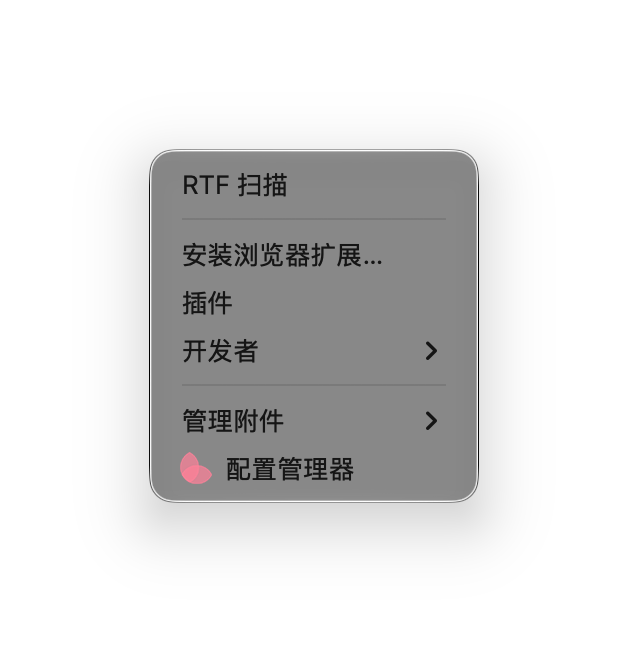
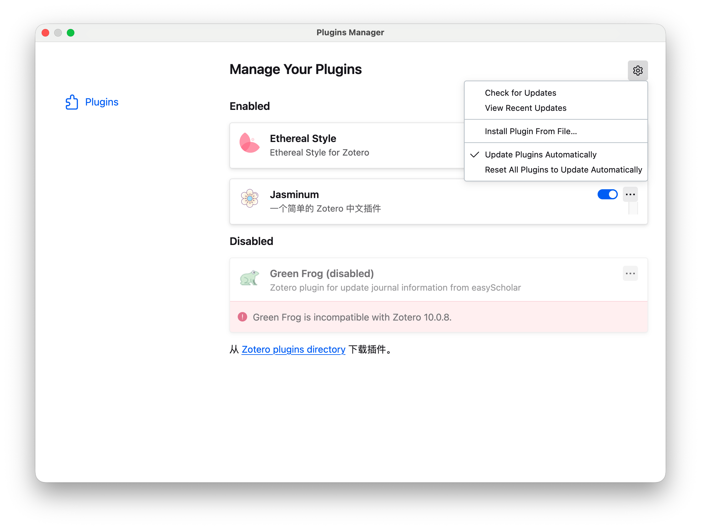
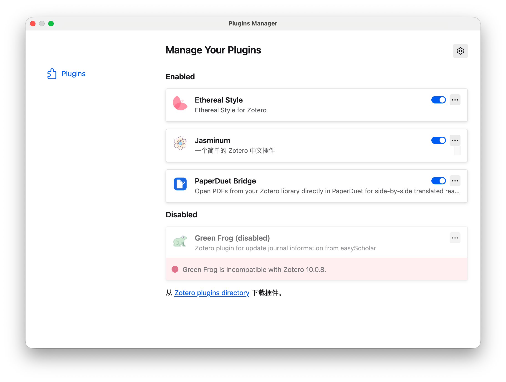
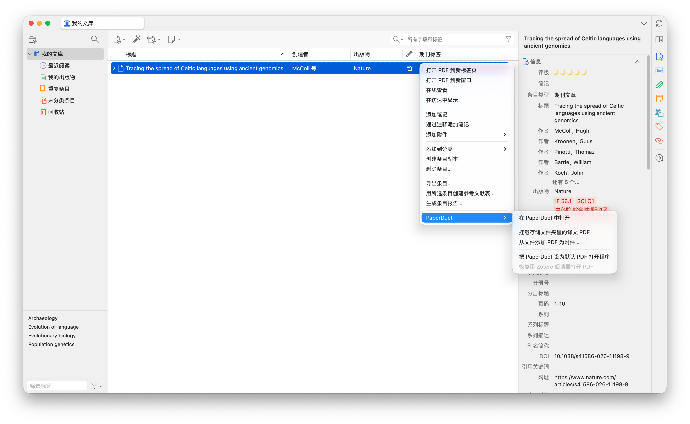
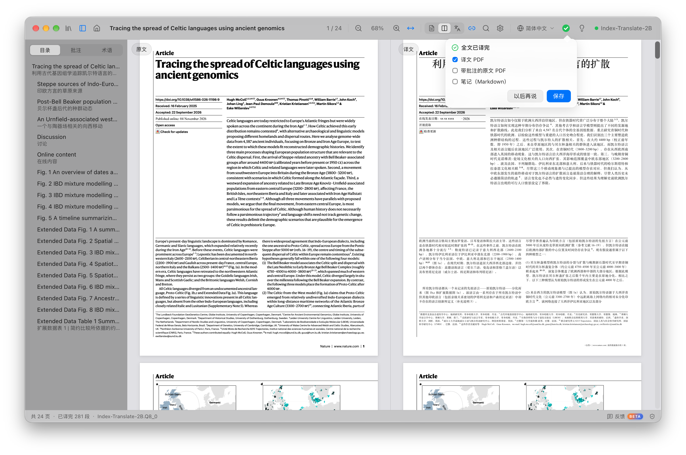
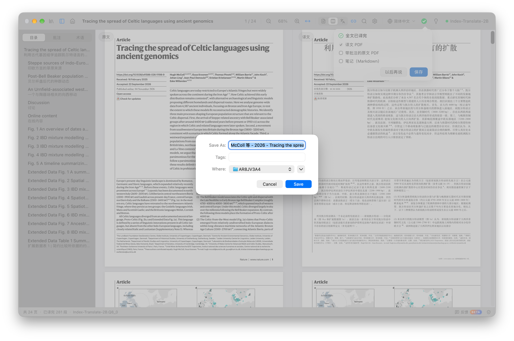
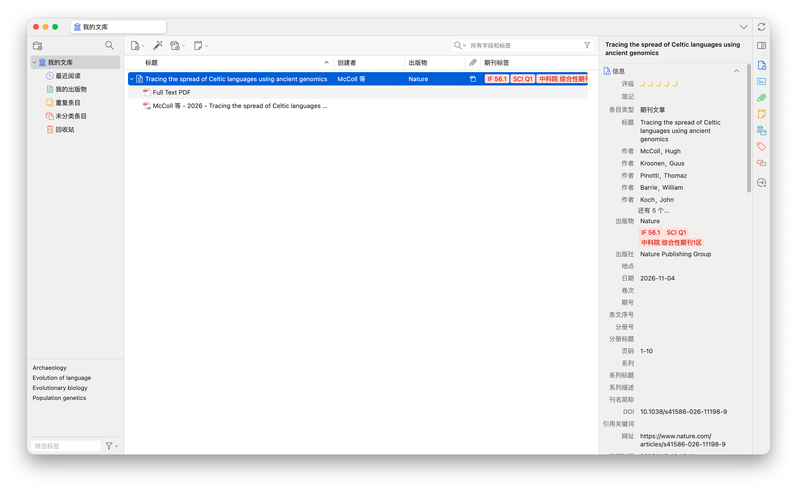
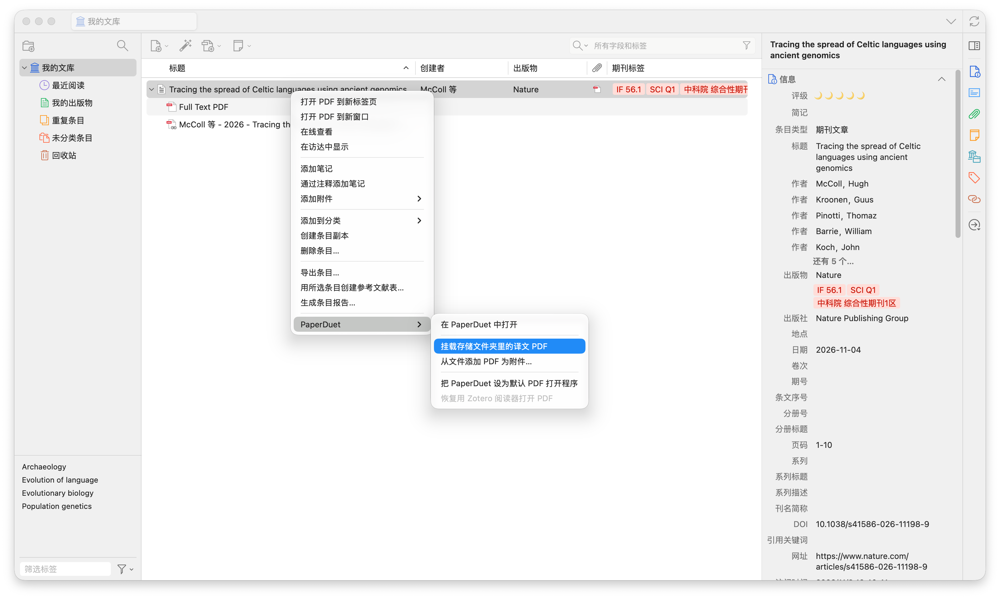
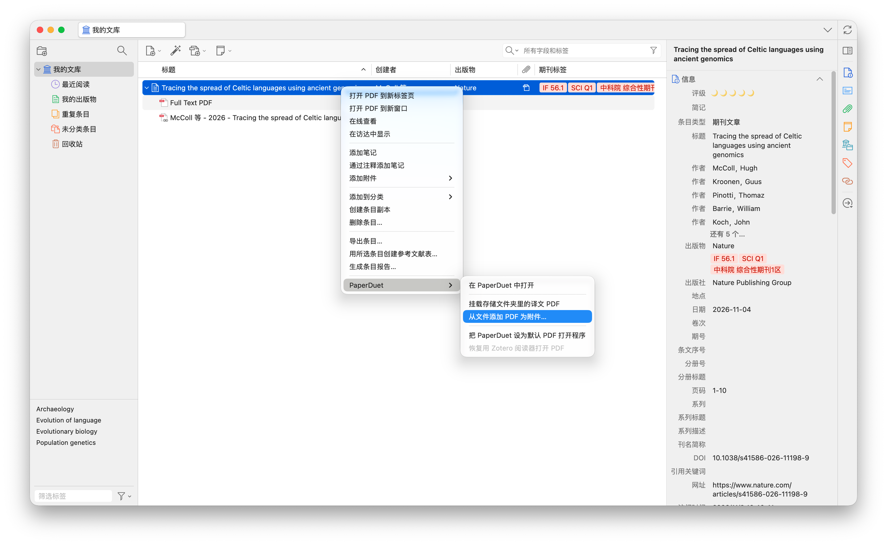

    <em>专为PaperDuet打造的Zotero插件</em> 

    
        <b href="README.md">简体中文</b> &middot;
        <a href="README.zh-traditional.md">繁体中文</a> 
    

    

PaperDuet Bridge是专门为PaperDuet开发的Zotero插件，可将Zotero文献库中的文献连接到PaperDuet进行翻译，同时可将已翻译好的文献直接保存到Zotero文献库中，便于文献的阅读与引用，为科研助力。
    
## PaperDuet是什么？

**PaperDuet**是一款由[**KalenHwei**](https://github.com/KalenHwei)开发的能保留格式的轻量级论文镜像AI翻译器，集成了6款开源AI翻译模型，可以按需下载并在本地进行部署，文献的翻译过程都在本地进行，无须担心隐私泄露等问题。同时，该软件也提供了在线API接入功能，用户可按需选择。该翻译器无需注册，安装即用。

访问PaperDuet官网以获取更多信息：[paperduet.com](https://paperduet.com)

    

## PaperDuet Bridge是什么？

PaperDuet Bridge是专门为PaperDuet开发的Zotero插件，通过这款插件，可以方便地将Zotero文献库与PaperDuet进行连接，翻译后的文献可以直接保存到Zotero文献库或其他位置，该插件可将任何位置的译文进行链接，并在Zotero端显示，方便后续的文献阅读与引用。

    

## 开始使用

该插件已在Mac以及Windows操作系统下Zotero10进行测试均可正常运行，理论上支持Zotero7及以上版本。

**下载**

从[Release](https://github.com/HocfaiSun/PaperDuet-Bridge-For-Zotero/releases/latest)下载最新的Zotero插件`paperduet-bridge-1.6.0.xpi`。

**安装**

打开`Zotero`，在菜单栏依次点击`工具`-`插件`-`齿轮`-`Install Plugin from File`，选择已下载的插件，即可安装。安装后，在`Manage Your Plugins`页面会看到`PaperDuet Bridge`已经显示。

   
  点击【工具】

   
  点击【插件】

   
  点击【齿轮图标】并选择【Install Plugin from File】

   
  插件已安装成功并显示

**使用**

**1.翻译文献**
在`Zotero`任一文献条目`右键`（或者打开PDF后右键），选择`PaperDuet`-`在PaperDuet中打开`，`PaperDuet`会立即打开并开始翻译该文献。

   
  通过PaperDuet翻译

**2.保存译文**
文献翻译完成后，会弹出全文已译完提示，点击`保存`按钮，会弹出保存界面，插件已经将保存地址默认设置为原文所在的路径，这样的话原文与译文都在同一个文件夹，便于管理，直接点击`Save`保存即可，如果不想将译文保存在同一个文件夹，可以自行选择其他保存路径。

   
  PaperDuet翻译完毕并提示

   
  译文默认保存到原文文件夹

如果保存的路径是默认路径，打开`Zotero`可以看到刚刚保存的译文已经自动识别并显示。如果译文并未显示，可以在该条目`右键`，选择`PaperDuet`-`挂载存储文件夹里的译文PDF`，即可正常显示。

   
  译文已在条目下显示

   
  将与原文同一路径下的译文挂载到条目

如果译文保存在其他路径，可以在该条目`右键`，选择`PaperDuet`-`从文件添加PDF为附件`，保存在其他路径的译文会正常挂载在该条目下。

   
  将与原文不同路径下的译文挂载到条目

## 说明

以上图片示例来自Mac OS，Windows系统下操作步骤一致，只是软件布局有差异。
## 致谢

感谢[**KalenHwei**](https://github.com/KalenHwei)开发了PaperDuet这款翻译器，PaperDuet Bridge插件也是在PaperDuet的基础以及启发下开发的，希望能够为大家带来便利。

图片演示论文来自**Hugh McColl**等人2026年11月04日发表在*Nature*期刊上的文章：[Tracing the spread of Celtic languages using ancient genomics](https://www.nature.com/articles/s41586-026-11198-9)。

## 版权
PaperDuet Bridge插件为免费插件，禁止用于商业用途！
