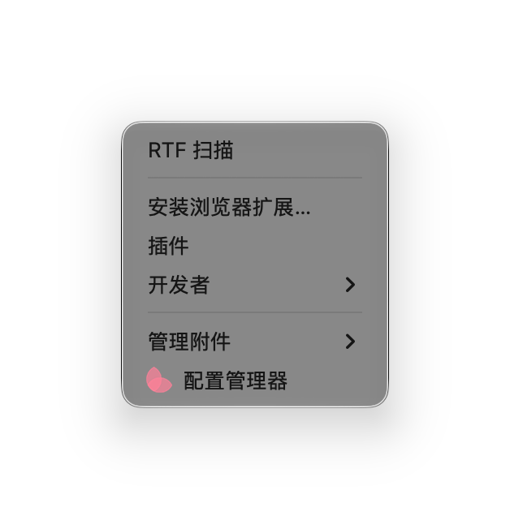
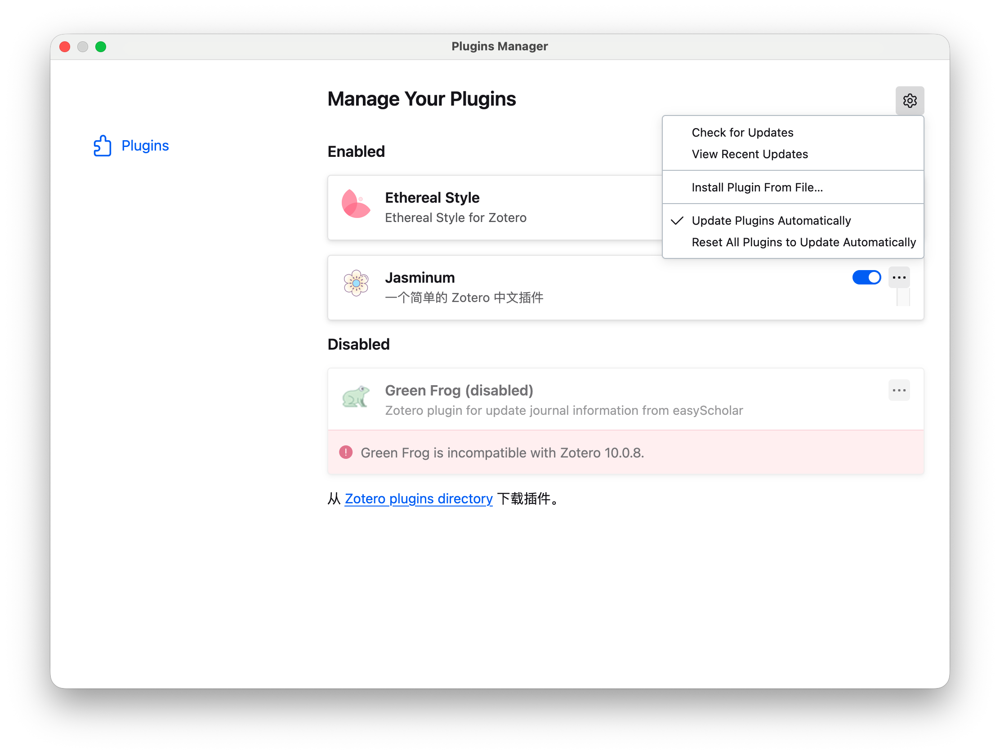
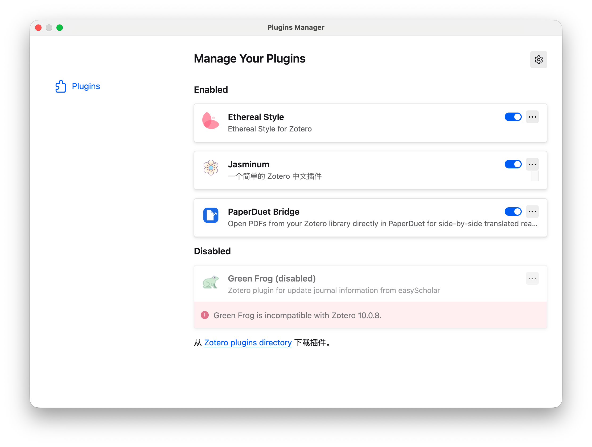
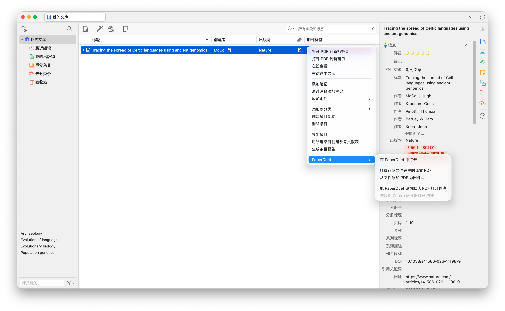
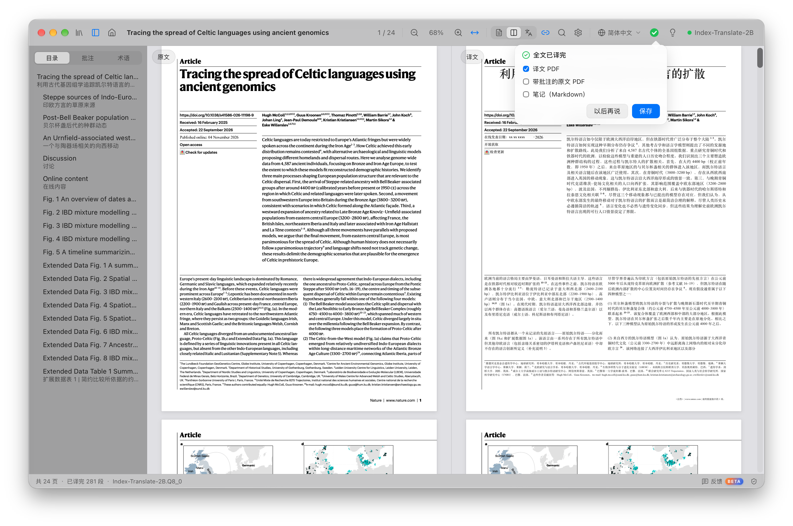
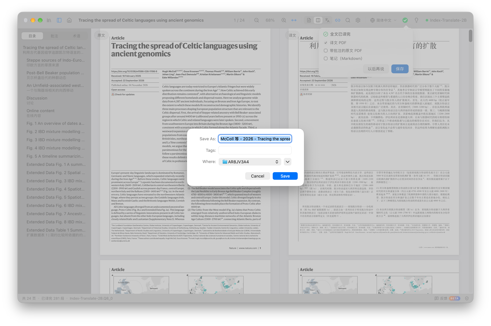
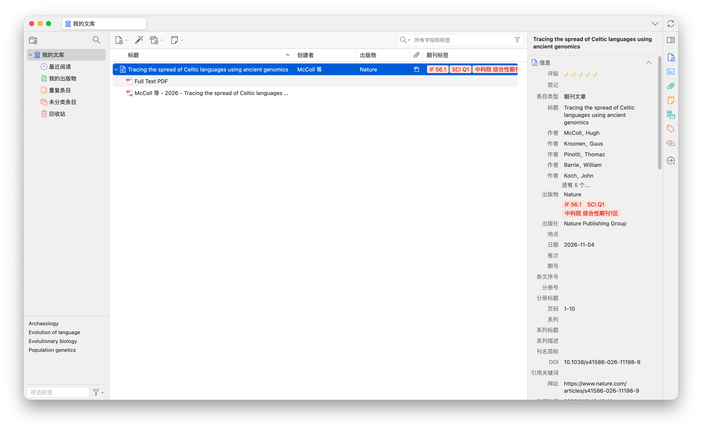
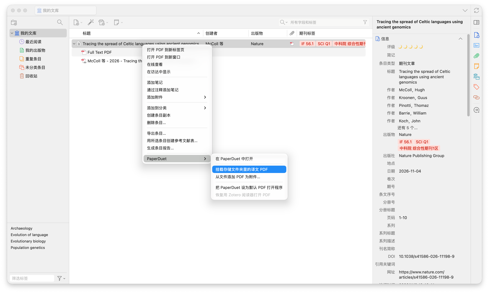
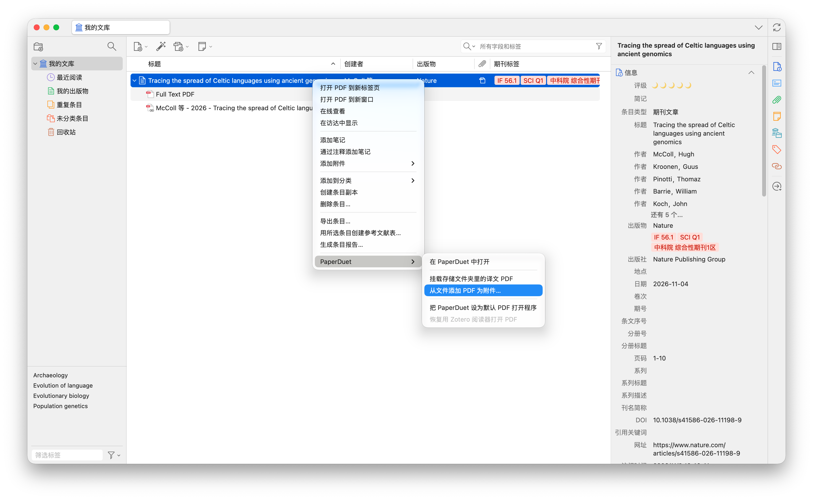

    <em>專為PaperDuet打造的Zotero插件</em> 

    
        <a href="README.md">简体中文</a> &middot;
        <b href="README.zh-traditional.md">繁体中文</b> 
    

    

PaperDuet Bridge是專門為PaperDuet開發的Zotero插件，可將Zotero文獻庫中的文獻連接到PaperDuet進行翻譯，同時可將已翻譯好的文獻直接保存到Zotero文獻庫中，便於文獻的閱讀與引用，為科研助力。
    
## PaperDuet是什麼？

**PaperDuet**是一款由[**KalenHwei**](https://github.com/KalenHwei)開發的能保留格式的輕量級論文鏡像AI翻譯器，集成了6款開源AI翻譯模型，可以按需下載並在本地進行部署，文獻的翻譯過程都在本地進行，無須擔心隱私洩露等問題。同時，該軟件也提供了在線API接入功能，用戶可按需選擇。該翻譯器無需註冊，安裝即用。

訪問PaperDuet官網以獲取更多信息：[paperduet.com](https://paperduet.com)

    

## PaperDuet Bridge是什麼？

PaperDuet Bridge是專門為PaperDuet開發的Zotero插件，通過這款插件，可以方便地將Zotero文獻庫與PaperDuet進行連接，翻譯後的文獻可以直接保存到Zotero文獻庫或其他位置，該插件可將任何位置的譯文進行連結，並在Zotero端顯示，方便後續的文獻閱讀與引用。

    

## 開始使用

該插件已在Mac以及Windows操作系統下Zotero10進行測試均可正常運行，理論上支持Zotero7及以上版本。

**下載**

從[Release](https://github.com/HocfaiSun/PaperDuet-Bridge-For-Zotero/releases/latest)下載最新的Zotero插件`paperduet-bridge-1.6.0.xpi`。

**安裝**

打開`Zotero`，在菜單欄依次點擊`工具`-`插件`-`齒輪`-`Install Plugin from File`，選擇已下載的插件，即可安裝。安裝後，在`Manage Your Plugins`頁面會看到`PaperDuet Bridge`已經顯示。

   
  點擊【工具】

   
  點擊【插件】

   
  點擊【齒輪圖標】並選擇【Install Plugin from File】

   
  插件已安裝成功並顯示

**使用**

**1.翻譯文獻**
在`Zotero`任一文獻條目`右鍵`（或者打開PDF後右鍵），選擇`PaperDuet`-`在PaperDuet中打開`，`PaperDuet`會立即打開並開始翻譯該文獻。

   
  通過PaperDuet翻譯

**2.保存譯文**
文獻翻譯完成後，會彈出全文已譯完提示，點擊`保存`按鈕，會彈出保存界面，插件已經將保存地址默認設置為原文所在的路徑，這樣的話原文與譯文都在同一個文件夾，便於管理，直接點擊`Save`保存即可，如果不想將譯文保存在同一個文件夾，可以自行選擇其他保存路徑。

   
  PaperDuet翻譯完畢並提示

   
  譯文默認保存到原文文件夾

如果保存的路徑是默認路徑，打開`Zotero`可以看到剛剛保存的譯文已經自動識別並顯示。如果譯文並未顯示，可以在該條目`右鍵`，選擇`PaperDuet`-`掛載存儲文件夾裡的譯文PDF`，即可正常顯示。

   
  譯文已在條目下顯示

   
  將與原文同一路徑下的譯文掛載到條目

如果譯文保存在其他路徑，可以在該條目`右鍵`，選擇`PaperDuet`-`從文件添加PDF為附件`，保存在其他路徑的譯文會正常掛載在該條目下。

   
  將與原文不同路徑下的譯文掛載到條目

## 說明

以上圖片示例來自Mac OS，Windows系統下操作步驟一致，只是軟件佈局有差異。
## 致謝

感謝[**KalenHwei**](https://github.com/KalenHwei)開發了PaperDuet這款翻譯器，PaperDuet Bridge插件也是在PaperDuet的基礎以及啟發下開發的，希望能夠為大家帶來便利。

圖片演示論文來自**Hugh McColl**等人2026年11月04日發表在*Nature*期刊上的文章：[Tracing the spread of Celtic languages using ancient genomics](https://www.nature.com/articles/s41586-026-11198-9)。